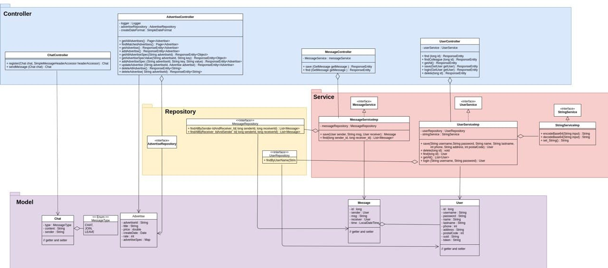

# Evar: Classified Ads Marketplace Backend

A Spring Boot backend for an online classified ads marketplace, similar to Divar or eBay Classifieds. Users can post and search ads, message each other, and chat in real time.

**Stack:** Java 8, Spring Boot 2.2, Spring Data JPA, Spring Data MongoDB, PostgreSQL, MongoDB, QueryDSL, WebSocket (STOMP + SockJS), Swagger, Maven

## Highlights

- **Two databases, each used for what it does best:** PostgreSQL for structured, relational data (users and messages) and MongoDB for ads, whose attributes vary by category
- **Dynamic ad search** with QueryDSL: filter by any combination of title, date, price, rating and custom attributes, with pagination and sorting
- **Flexible ad attributes:** each ad stores a key-value map of specs (for example `brand=Toyota`, `year=2018`), so new categories need no schema changes
- **Real-time chat** over WebSocket using STOMP and SockJS
- **Layered architecture:** controllers, services (interfaces and implementations), repositories and models
- **API documentation** generated with Swagger

## Architecture



| Layer | Components |
|---|---|
| Controller | `AdvertiseController`, `UserController`, `MessageController`, `ChatController` |
| Service | `UserService`, `MessageService`, `StringService` (interfaces with implementations) |
| Repository | `AdvertiseRepository` (MongoDB + QueryDSL), `UserRepository` and `MessageRepository` (JPA / PostgreSQL) |
| Model | `Advertise`, `User`, `Message`, `Chat` |

## API

### Ads (`/advertise`)

| Method | Endpoint | Description |
|---|---|---|
| GET | `/advertise` | List all ads (paginated) |
| GET | `/advertise/search` | Search ads by `title`, `createDate`, `price`, `rate` and `spec`, with `page`, `size` and `sorter` |
| GET | `/advertise/{advertiseId}` | Get one ad |
| POST | `/advertise/create` | Create an ad |
| PUT | `/advertise/update/{advertiseId}` | Update an ad |
| DELETE | `/advertise/delete/{advertiseId}` | Delete an ad |
| DELETE | `/advertise/delete` | Delete all ads |
| GET | `/advertise/advertiseSpec/{advertiseId}` | Get all attributes of an ad |
| GET | `/advertise/advertiseSpec/{advertiseId}/{key}` | Get one attribute |
| POST | `/advertise/advertiseSpec/{advertiseId}/{key}/{value}` | Add an attribute |

**Search example:** find ads titled "car" created after January 1, 2021, with a specific brand and year, sorted by price:

```
GET /advertise/search?title=car&createDate=2021-01-01&spec=brand=Toyota,year=2018&sorter=price
```

### Users (`/user`)

| Method | Endpoint | Description |
|---|---|---|
| POST | `/user/add` | Register a user |
| POST | `/user/login` | Log in and receive a token |
| GET | `/user/find` | Get a user by ID |
| GET | `/user/get-all` | List all users |
| POST | `/user/delete` | Delete a user |

### Messages (`/message`)

| Method | Endpoint | Description |
|---|---|---|
| POST | `/message/add` | Send a message to another user |
| GET | `/message/get-all` | Get the conversation between two users |

### Real-time chat (WebSocket)

| Destination | Description |
|---|---|
| `/javatechie` | SockJS connection endpoint |
| `/app/chat.register` | Join the chat |
| `/app/chat.send` | Send a message |
| `/topic/public` | Subscribe to receive messages |

A simple chat client is included at `src/main/resources/static/index.html`.

## Getting Started

### Prerequisites

- Java 8 or later
- Maven
- PostgreSQL running on `localhost`
- MongoDB running on `localhost:27017`

### Configure

Update the PostgreSQL connection in `src/main/resources/application.properties`:

```properties
spring.datasource.url=jdbc:postgresql://localhost/postgres
spring.datasource.username=postgres
spring.datasource.password=YOUR_PASSWORD
```

### Run

```bash
mvn spring-boot:run
```

The app starts on port **8105**.

- API docs: http://localhost:8105/swagger-ui.html
- Chat client: http://localhost:8105

## Project Structure

```
src/main/java/ir/iust/computer/ood/evar/
├── controller/       # REST and WebSocket controllers, DTOs
├── Service/          # Service interfaces
│   └── Imp/          # Service implementations
├── repository/       # JPA and MongoDB repositories
├── model/            # Entities and documents
├── configuration/    # WebSocket and Swagger config
└── util/             # Shared response wrapper
```
